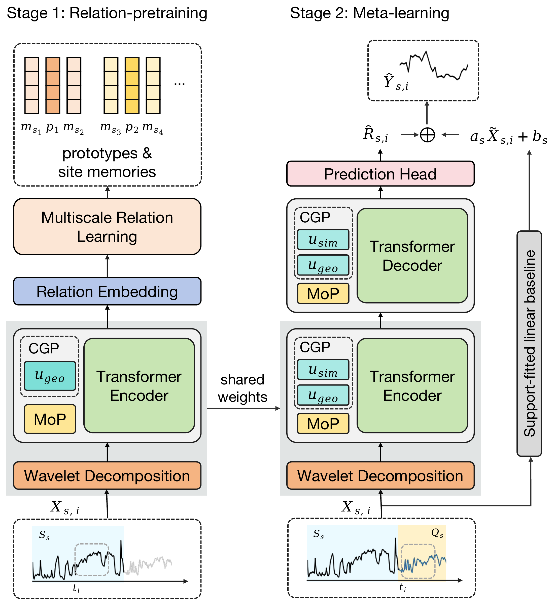

# GeoReCal: Relation-Aware Cross-Variable Reconstruction for Geoscientific Data Completion


Geoscientific records provide essential evidence for understanding environmental change, yet uneven coverage of measured variables limits their joint analysis. Reconstructing unavailable variables from contemporaneous auxiliary observations can make fuller use of existing geological and environmental records. However, auxiliary–target relationships vary across sites and environmental conditions. Learning separately at each site may overlook shared influences of regional climate, whereas transferring a shared mapping without local calibration can obscure site-specific responses. We propose GeoReCal (Geoscientific Reconstruction through Relation-Aware Calibration), a relation-aware framework that combines cross-site relationship learning with local calibration for contemporaneous cross-variable reconstruction. The model comprises two main components: (1) learning reusable relationship representations through contrastive learning on paired auxiliary and target histories across temporal scales, capturing how variables co-vary rather than modeling auxiliary trajectories alone; and (2) using the available paired observations at each site to establish a basic linear response and provide relationship context to condition a shared nonlinear residual model. Training across tasks learns an initialization that can be refined using local paired observations, combining transferable relationship knowledge with a correction tailored to the site's temporal response. Experiments across diverse geoscientific reconstruction tasks demonstrate improved accuracy over representative time-series architectures and adapted pretrained models. Further analyses substantiate the roles of paired relationship learning and local calibration, supporting GeoReCal as an effective approach to geoscientific data completion.

## Framework

<p align="center">
  
</p>

## Repository Structure

```text
GeoReCal/
├── data_provider/                 # Task construction and support/query windows
├── dataset/                       # Prepared datasets and metadata
├── cluster/                       # Sediment site clusters for five-fold splits
├── models/                        # Reconstruction model and relation pretraining
├── layers/                        # Attention, expert prefixes, and prediction head
├── exp/                           # Relation pretraining, MAML, and evaluation
├── scripts/                       # One script per reconstruction task
├── utils/                         # Metrics, result saving, and early stopping
├── run.py                         # Training and evaluation entry point
├── summarize_fivefold.py          # Pooled five-fold metrics
└── requirements.txt
```

## Installation

The experiments use Linux, Python 3.10, and PyTorch 2.1.2 with CUDA 11.8.
From the repository root, create an environment and install the pinned dependencies:

```bash
conda create -n georecal python=3.10 -y
conda activate georecal
python -m pip install -r requirements.txt
```

The requirements include the CUDA 11.8 PyTorch wheel. Use an NVIDIA GPU with a compatible driver; see the [PyTorch installation instructions](https://pytorch.org/get-started/previous-versions/#v212).

## Run a Task

For example, reconstruct magnetic susceptibility (MS) from P-wave velocity (PWL):

```bash
CUDA_VISIBLE_DEVICES=0 bash scripts/georecal_sediment_crossvar_pwl_ms.sh results/pwl_ms_run2
```

This script runs relation pretraining, five-fold MAML training and evaluation, and aggregation of all five folds' query predictions. The optional first argument specifies a new output directory. Choose an unused directory when repeating an experiment.

The other reconstruction tasks follow the same script interface in `scripts/`. Model and training hyperparameters are specified in each task script. The entry point runs on one GPU by default; pass `--no-use_gpu` to `run.py` to select the CPU.

## License

This repository is distributed under the [Apache License 2.0](LICENSE).
